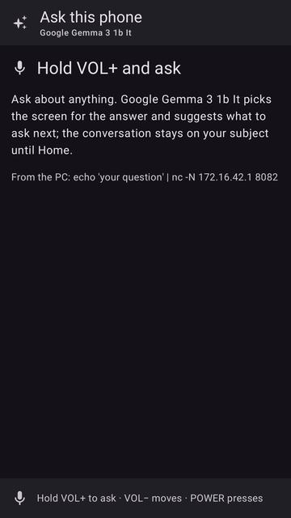

# nexus5x-local-llm

Small language models (Gemma 3, Qwen 2.5, Llama 3.2, SmolLM...) running on a
2015 **Nexus 5X** (bullhead) with **no Android at all**: just a trimmed Linux
kernel, BusyBox and llama.cpp. The phone does the inference on its CPU, with
the model in its 2 GB of RAM. You chat with it from a browser on the PC, or
from a mobile on the same Wi-Fi, or **talk to the phone itself**: hold
VOLUME DOWN, ask, and it answers on its screen and, if you want, out loud,
remembering the conversation. Booted with `fastboot boot` only: nothing is
flashed, and the phone's Android is untouched.

<p align="center"></p>

<sub>The phone's own screen (captured from its framebuffer): waiting for a model, receiving one over USB, ready.</sub>

**Answers as screens** ([A2UI](#a2ui-screens-optional), optional; Gemma 3 1B): ask what system calls are, read the answer with the volume key, then press one of the suggested questions:

<p align="center"></p>

<sub>Captured from the phone's framebuffer. While the model writes, the GIF runs 16 times faster (marked 16x):
each answer took about 3 minutes on the phone; the key presses are real time. The answers are the model's,
unedited, glitches included (the stray `")},{` after the first paragraph, which the app now removes, and the
cut-off `open(` example).</sub>

**Voice chat on the phone** (Gemma 3 1B, real time; three questions in one conversation):

<p align="center"></p>

<sub>Captured from the phone's framebuffer, a frame every 1.5 s or so.
**[With sound (MP4)](docs/media/voice-chat.mp4)**: the questions as the phone's
microphone recorded them, and the answers as the phone's eSpeak NG voice says
them, placed at the moments the screen shows. For this recording the
questions were synthetic speech played through the phone's own speaker. The
answers are the model's, unedited; a 1B model gets facts wrong (3776 m is
about 12,388 feet, and Fuji is classed as active).</sub>

**Chat in the PC browser** (Qwen2.5 Coder 0.5B on the phone, real time, ~9.5 tokens/s):

<p align="center"></p>

**Chat from a mobile over Wi-Fi** (Gemma 3 1B on the phone, real time, ~5 tokens/s):

<p align="center"></p>

**Loading a model** from the PC app (Ollama models on the PC → the phone, over USB):

<p align="center"></p>

<sub>Recorded from headless Chromium driving the real pages, at real speed (full-quality MP4s:
[PC app](docs/media/pc-app.mp4), [PC chat](docs/media/pc-chat.mp4), [mobile chat](docs/media/mobile-chat.mp4)).
The mobile view is Chromium's phone emulation (390×844) opening the chat through the Wi-Fi share.
The PC app has gained a *Voice on the phone* section since.</sub>

## Why

A Nexus 5X has a Snapdragon 808 (2× Cortex-A57 + 4× Cortex-A53, ARMv8.0,
no dot-product instructions) and 2 GB of RAM: about the floor of what still
runs a modern language model. Under Android, a big part of that RAM and CPU
belongs to the OS. Here **nothing else runs**, so what you measure is the
hardware and the model:

- **Try small models on old or low-end hardware**: how fast a 0.5B or 1B
  model really is on a 2015 phone CPU, which ones fit in 2 GB, what
  quantization costs, how heat limits a long answer.
- **Pick a model for an offline/edge device** before building one.
- **Give an old phone a job**: a private, offline chatbot or voice
  assistant on the desk. Nothing you say or type leaves the phone and the PC.

## How little runs on the phone

There is **no Android**: no Zygote, no ART/Java, no `system_server`, no
SurfaceFlinger, no Binder (not even compiled in), no SELinux, no vold, no
`/system` or `/data`. The boot chain is:

```
bootloader ─▶ Linux 3.10 kernel ─▶ BusyBox init ─▶ 5 small services
                (trimmed)            (PID 1)        llmd · llama serve · llm-ui · httpd · telnetd
```

Measured on the phone with Gemma 3 1B and the voice pack loaded:

| | |
|---|---|
| **Processes** | 8: `init`, `udhcpd`, `llmd` (+ its `nc` waiting for the next upload), `llama serve`, `llm-ui`, `httpd`, `telnetd`. Voice chat starts `whisper-cli` and `espeak-ng` for a moment per question |
| **Files** | the whole system is a 14.4 MB boot image; its RAM disk holds `/bin` with 9 files: `llama` (17 MB, llama.cpp), `llm-ui` (4 MB, the screen and voice chat), `busybox` (2 MB), 2 tiny C tools and 4 shell scripts. The voice pack (53 MB) comes over USB after boot, into RAM |
| **Storage** | every file system is in RAM (`rootfs`, `tmpfs`, `proc`, `sysfs`, `devtmpfs`). The only exception: for audio, the phone's own `vendor` partition is mounted **read-only** (ext4 `ro,noload`, so not even a journal replay writes) to read the audio DSP's firmware. Nothing else on the storage is opened |
| **RAM** | 1.83 GB total. With Gemma 3 1B at 32K context: the model file 806 MB and the voice pack 53 MB (both in `tmpfs`), llama.cpp's cache and buffers 251 MB, **everything else about 50 MB**; ~750 MB stay free |
| **Kernel** | LineageOS 15.1's bullhead kernel with 876 of its 1282 built-in options: no modem, radios, GPU, camera, touch, sensors, netfilter or IPv6 |
| **Network** | only USB (RNDIS gadget): the phone is `172.16.42.1`, the PC gets `172.16.42.2` by DHCP |

What stays in the kernel is what keeps the SoC safe and the phone usable:
power and regulators, cpufreq and the HMP scheduler, **thermal protection**
(msm_thermal, battery current limiting), charger and fuel gauge, the
watchdog, the display (the bootloader hands over a running splash screen),
the buttons, the USB gadget, and the audio path (ADSP, codec, eMMC/ext4 to
read its firmware).

```
PC (Linux)                                   Nexus 5X (172.16.42.1)
Nexus 5X LLM app ─ model / voice pack, :9000 ─▶ llmd ─▶ /tmp/model.gguf, /tmp/voice (RAM)
   (Ollama models)                            │
browser ─────────── web chat, :8080 ──────▶  llama serve (llama.cpp web UI + OpenAI-style API)
mobile ── Wi-Fi ──▶ PC :8080 ── forwarded ─▶  ″
                                              ▲ questions from the phone's mic
PC app ◀── voice state, conversations, :8081  llm-ui ─▶ screen: model, state, voice chat
                                                     ─▶ mic → Whisper; answers → eSpeak NG → speaker
```

## Try it on your Nexus 5X

You need:

- a **Nexus 5X with an unlocked bootloader** (*OEM unlocking* in Developer
  options, then `fastboot flashing unlock`, done once; it wipes the phone).
  Whatever Android is installed stays as it is.
- a **Linux PC** with `fastboot`, Python 3 and [Ollama](https://ollama.com)
  (only used as the model downloader), and a USB cable.

Steps:

1. **Get the boot image**: download the zip from
   [Releases](https://github.com/kaiwalyakhasnis/nexus5x-local-llm/releases/latest)
   (it holds `nexus5x-llm-boot.img`), or build it (see *Build from source*).
2. **Boot it** (RAM only, nothing is flashed):

   ```sh
   adb reboot bootloader          # or hold power + volume down
   fastboot boot nexus5x-llm-boot.img
   ```

   A few seconds later the phone shows *waiting for a model*, and a new USB
   network interface comes up on the PC.
3. **Start the PC app**: clone this repo, then

   ```sh
   python3 manager/nexus5x-llm.py --install   # once: adds "Nexus 5X LLM" to the app menu
   python3 manager/nexus5x-llm.py             # or start it directly; opens http://localhost:8765
   ```

   Click **Download & load** next to a model (`gemma3:1b` is a good first
   one), and wait for *ready*: a 1 GB model takes about a minute over USB.
4. **Chat**: click **Open chat** (http://172.16.42.1:8080). For these small
   models, open Settings → Tools in the chat and switch the built-in tools
   off; otherwise the page sends tool definitions with every message and a
   0.5B model answers with a made-up tool call.
5. **Talk to it**: under *Voice on the phone*, click **Download voice pack**
   once (53 MB, from the release; or build it). From then on the app sends
   it to the phone after every boot. Then **hold VOLUME DOWN**, ask your
   question, and let go: the answer appears on the phone's screen. The
   sound is off after boot; **VOLUME UP** turns it on, and the phone speaks
   its answers. Press VOLUME DOWN during an answer to stop it.
6. **On a mobile**: tick *Share the chat on Wi-Fi* in the app and scan the
   QR code. Anyone on that network can use the chat while it is on.
7. **Back to Android**: hold power for ~10 s, or
   `scripts/phone.py llm-reboot`. Nothing on the phone changed.

The model and the voice pack live in RAM, so after a reboot load the model
again (one click; the voice pack goes by itself). Any GGUF file works too,
without Ollama: `scripts/send-model.sh model.gguf`.

## Models and speed

Measured on the phone, answers of 200-400 tokens, 6 threads (all cores):

| Model (Ollama name) | File | Generation | Context | Notes |
|---|---|---|---|---|
| Qwen2.5 Coder 0.5B (`qwen2.5-coder:0.5b`) | 398 MB | ~9.5 tok/s, ~8 sustained | 32K | good for short code snippets |
| Qwen2.5 0.5B (`qwen2.5:0.5b`) | 398 MB | 10.3 tok/s (llama-bench) | 32K | general chat |
| Google Gemma 3 1B (`gemma3:1b`) | 806 MB | ~5.3 tok/s, prompt 11 tok/s | 32K | best quality that fits; the voice demo |

Models up to about **1.25 GB** fit (the app greys out bigger ones):
`gemma3:270m`, `qwen3:0.6b`, `qwen2.5-coder:1.5b`, `llama3.2:1b` in Q4_K_M,
`smollm2:360m` in Q8_0... Gemma 3n and Gemma 4 (3.5 GB and up) don't.

**Context window**: the server gets the context length the model was
trained with, up to **32K tokens** (`CTX_MAX` in
[`rootfs/etc/llm.conf`](rootfs/etc/llm.conf); `CTX=` overrides it). 32K is
about 24,000 words. Gemma 3 1B fits it easily: its sliding-window layers
keep the cache small (about 250 MB at 32K). A long input is slow, though:
the phone reads about 7-11 tokens a second, so this README (~4,000 tokens)
took 9.5 minutes to read before Gemma summarized it, and answers slow to
about 3 tok/s with that much in the context. Follow-up questions about the
same text are fast: llama.cpp keeps what it has read. Models whose cache
grows with every layer need much more RAM for the same context: at 32K the
cache alone would be ~3.7 GB for Qwen3 0.6B and ~1 GB for Llama 3.2 1B,
too much next to the model; set a smaller `CTX` for them (8192 fits).

**Heat**: under full load the A57 cores reach their 100 °C limit within a
second or two, and the stock thermal driver holds them at 768 MHz (instead of
1824) until they cool; the A53s stay at full speed. The numbers above are
with this protection on, and it stays on: the Nexus 5X is known for
heat-related failures. A bigger model doesn't make it hotter, only slower.

## Voice chat

Everything happens on the phone; the PC only delivers the voice pack.

1. **Hold VOLUME DOWN**: `llm-ui` records the bottom microphone (48 kHz,
   up to 30 s) while the screen shows *listening*.
2. **Let go**: [whisper.cpp](https://github.com/ggml-org/whisper.cpp) with
   Whisper tiny.en (English only, 44 MB) turns it into text in about 5 s.
3. The text goes to the model as the next message of the conversation;
   the answer streams onto the screen.
4. With the sound on, each finished sentence is spoken by
   [eSpeak NG](https://github.com/espeak-ng/espeak-ng) and played on the
   speaker while the model writes the next one.

From letting go to the first spoken word takes about 15 s with Gemma 3 1B.
The conversation goes on from question to question ("How tall is it?"
works), and the bottom of the screen shows how much of the context window it
fills. When the next exchange might not fit, or another model is loaded, a
new conversation starts. Every exchange is also logged, with the
conversation it belongs to, in `http://172.16.42.1:8081/conversations.jsonl`.

The audio path without Android:
[`config/audio.config`](config/audio.config) puts the audio DSP (ADSP), the
WCD9330 codec and eMMC/ext4 back into the kernel;
[`etc/llm-audio.sh`](rootfs/etc/llm-audio.sh) mounts the `vendor` partition
read-only for the ADSP firmware, boots the DSP and sets the mixer. The mixer
settings come from Android's own `mixer_paths.xml`, converted to `tinymix`
scripts by [`tools/mixer-path.py`](tools/mixer-path.py) into
[`rootfs/etc/audio/`](rootfs/etc/audio/). Qualcomm's DSP PCM driver needs
two fixes in tinyalsa ([`patches/tinyalsa/`](patches/tinyalsa/)): read one
period per call, and never let ALSA stop a stream on an under- or overrun
(the driver doesn't recover from that).

Limits: English only; Whisper tiny mishears some words, the more so with
noise or a quiet voice; the speaker voice is eSpeak's robotic one; recording
and playing at the same time is avoided (the DSP driver doesn't like it).

## The phone's screen

`llm-ui` ([`ui/`](ui/), minui on the framebuffer) shows the model's logo and
name, its state (waiting / receiving / loading / ready / failed), the voice
chat, and the chat URL; battery, CPU and RAM use sit in the top corner,
updated every second. POWER turns the screen off and on, VOLUME DOWN is
push-to-talk, VOLUME UP turns the sound on and off. The name comes from the
model file itself ([`tools/gguf-name.c`](tools/gguf-name.c) reads the GGUF
metadata, including the trained context length), the logo from the name:
Gemma, Qwen, Llama (Meta), SmolLM (Hugging Face), DeepSeek, else Ollama's
llama. When a new model starts arriving, `llmd` frees the old one first: two
don't fit in RAM.

## A2UI screens (optional)

[`a2ui/`](a2ui/README.md) is another screen for the phone: ask a question
(hold VOLUME UP, or send it from the PC) and the model answers with a
*screen*, written in [A2UI](https://a2ui.org) (Google's Agent-to-User
Interface protocol) and drawn as Material 3 components: cards, chips,
sliders, and the questions you might ask next as buttons. VOLUME DOWN reads
through the answer, then moves between the buttons; POWER presses.

It is written in Kotlin with
[embedded-compose](https://github.com/kaiwalyakhasnis/embedded-compose)
(Jetpack Compose's runtime on minui) and
[embedded-compose-a2ui](https://github.com/kaiwalyakhasnis/embedded-compose-a2ui)
(the A2UI renderer), so it needs checkouts of both, next to this repo (or
`EMBEDDED_COMPOSE=` and `EC_A2UI=` in `local.env`). It isn't in the boot
image: it goes into the running phone's RAM, in place of `llm-ui`.

```sh
scripts/build-a2ui.sh          # out/a2ui/: the binary and its fonts
scripts/a2ui-phone.sh          # run it on the phone instead of llm-ui (again after a rebuild)
scripts/a2ui-phone.sh --back   # back to llm-ui (so does a reboot)
echo 'what is DNS' | nc -N 172.16.42.1 8082   # ask from the PC
```

## How it is built

- **Kernel**: LineageOS's bullhead kernel (`lineage-15.1`, 3.10) plus the
  four commits in [`patches/`](patches/): the `dtc` fix for modern host
  compilers, and three fixes that let the smaller config build (gadget MIDI
  without ALSA, the LG backlight hook without MDSS, a missing include in
  dw8768). [`config/local-llm.config`](config/local-llm.config) is merged
  onto `lineageos_bullhead_defconfig`, then
  [`config/audio.config`](config/audio.config) puts the audio path back;
  their comments say what each section removes or restores, and why.
  `FRAG=config/local-llm.config` builds the kernel without audio.
- **Ramdisk** ([`rootfs/`](rootfs/)): BusyBox `init` runs
  [`etc/rc`](rootfs/etc/rc), [`etc/llm-usb.sh`](rootfs/etc/llm-usb.sh) (RNDIS
  + DHCP) and [`etc/llm-cpu.sh`](rootfs/etc/llm-cpu.sh) (the CPU, scheduler,
  idle and DDR bandwidth setup from Android's `init.bullhead.power.sh`), then
  keeps [`llmd`](rootfs/bin/llmd), `llm-ui`, `httpd` and `telnetd` running.
- **llama.cpp** v0.7.0: static aarch64 build with `-mcpu=cortex-a57`, CPU
  backend only, the unified `llama` binary with the web UI embedded
  ([`scripts/build-llama.sh`](scripts/build-llama.sh)).
- **Voice pack** ([`scripts/build-voice.sh`](scripts/build-voice.sh)):
  static aarch64 builds of whisper.cpp v1.9.5, eSpeak NG 1.52.0 and
  tinyalsa v2.0.0, the Whisper tiny.en model and eSpeak's English data. It
  doesn't fit in the boot image, so it travels like a model: `llmd`
  recognizes the tar and unpacks it into RAM. `llm-ui` itself links
  tinyalsa.
- **Boot image**: the ramdisk is LZMA-compressed so the image stays at
  14.4 MB; at 16 MB the bootloader no longer starts it.
- **PC app** ([`manager/`](manager/)): one Python file (standard library
  only) and one HTML page.

## Build from source

Needs a Linux PC with `g++-aarch64-linux-gnu`, `gcc`, `g++`, `make`, `git`,
`curl`, `cpio`, `lzma`, `python3` with `python3-pil` and `python3-venv`. No
Android or LineageOS tree is needed.

```sh
scripts/fetch-sources.sh    # kernel + patches, llama.cpp, whisper.cpp, eSpeak NG, tinyalsa, BusyBox, cmake, GCC 4.9
scripts/build-kernel.sh     # out/kobj/arch/arm64/boot/Image.gz-dtb
scripts/build-llama.sh      # out/llama/bin/llama
scripts/build-bootimg.sh    # out/boot.img
scripts/build-voice.sh      # out/voice-pack.tar (the PC app finds it there)
fastboot boot out/boot.img
```

The kernel needs GCC 4.9 (current GCCs can't build 3.10): `fetch-sources.sh`
takes AOSP's. With a LineageOS 15.1 tree, `LINEAGE=/path` in an untracked
`local.env` uses that one instead.

Command line tools, for scripting and debugging:

```sh
scripts/send-model.sh qwen2.5:0.5b      # Ollama model name, or a .gguf path
nc -N 172.16.42.1 9000 < out/voice-pack.tar   # the voice pack, without the app
scripts/chat.py                         # chat in the terminal; prints tok/s
scripts/phone.py 'llm bench'            # llama-bench on the phone (telnet)
scripts/phone.py 'echo CTX=8192 > /tmp/llm.conf; llm-serve'    # change settings
scripts/phone.py 'echo "sound on" > /tmp/ptt'                  # what VOLUME UP does ("down"/"up": VOLUME DOWN)
scripts/push.sh f /bin/f 755            # copy a file into the running phone (RAM)
scripts/screencap.py screen.png         # the phone's screen
scripts/phone.py 'llm-reboot bootloader'                       # back to fastboot
```

`make -C ui ../out/ui/preview` builds a PC version of the screen that
renders to an image, for working on `llm-ui` without the phone.

QEMU (userspace only, with the 3.10 QEMU kernel from `~/bullhead-qemu`):
`scripts/run-qemu.sh model.gguf`.

## Debugging boot hangs

pstore does not survive any reboot on bullhead, and without a UART there is
no log. `scripts/probe-boot.sh <kobj>` boots a kernel with a tiny ramdisk
whose init reboots into fastboot: ending in fastboot means userspace was
reached; an apps watchdog bark ends in Android instead.
`scripts/bisect-config.sh` builds fragments from sections or single options
of `config/local-llm.config`. This is how the networking hang was found
(see the comment in that section).

## Licenses and credits

- Linux kernel 3.10 (GPL-2.0): [LineageOS/android_kernel_lge_bullhead](https://github.com/LineageOS/android_kernel_lge_bullhead)
  `lineage-15.1` + [`patches/`](patches/)
- [llama.cpp](https://github.com/ggml-org/llama.cpp) v0.7.0 and its web UI (MIT)
- BusyBox 1.36.1 (GPL-2.0), Ubuntu's `busybox-static` build ([source](https://busybox.net/downloads/busybox-1.36.1.tar.bz2))
- minui (Apache-2.0), from AOSP via [nexus5x-hike-buddy](https://github.com/kaiwalyakhasnis/nexus5x-hike-buddy)
- [tinyalsa](https://github.com/tinyalsa/tinyalsa) v2.0.0 (BSD-3-Clause) +
  [`patches/tinyalsa/`](patches/tinyalsa/), in `llm-ui` and the voice pack
- The mixer scripts in [`rootfs/etc/audio/`](rootfs/etc/audio/) are generated from
  LineageOS/AOSP `device/lge/bullhead/mixer_paths.xml` (Apache-2.0)
- Voice pack (a separate download): [whisper.cpp](https://github.com/ggml-org/whisper.cpp)
  v1.9.5 (MIT) with OpenAI's Whisper tiny.en model (MIT), and
  [eSpeak NG](https://github.com/espeak-ng/espeak-ng) 1.52.0 (GPL-3.0-or-later);
  their licenses and source links are inside the pack
- The logos in [`ui/assets/`](ui/assets/) belong to Google (Gemma), Alibaba
  (Qwen), Meta, Hugging Face, DeepSeek and Ollama; they are shown only to
  identify which family a model comes from.
- Models are downloaded by you through Ollama, under each model's own license.
