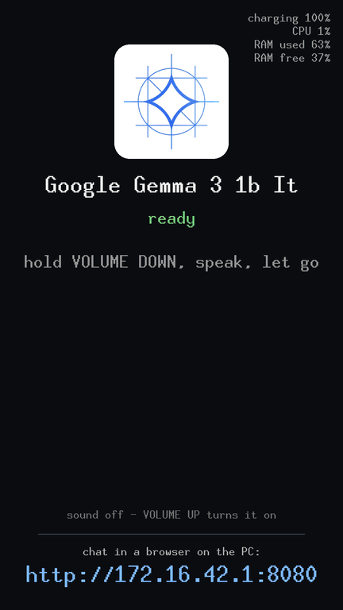
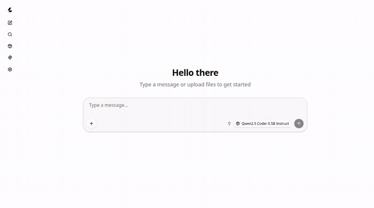
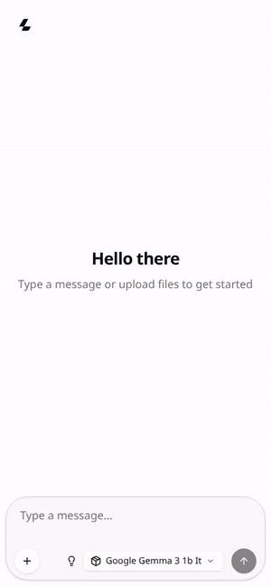
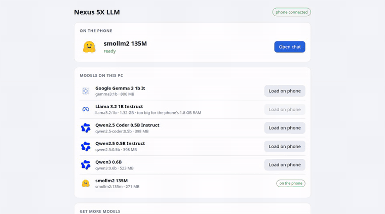
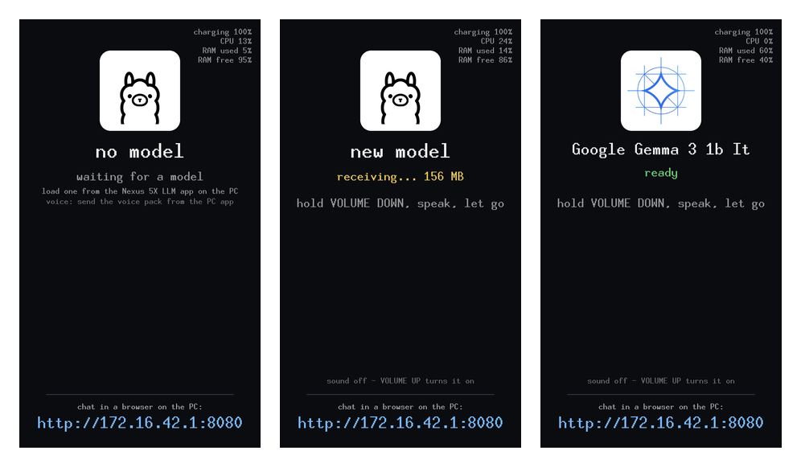

# Chat and voice

The model on the phone answers in three ways besides the [A2UI screen](../a2ui/README.md):
the web chat in a browser on the PC (or a mobile on the same Wi-Fi), the PC app
that loads models, and voice chat on the phone itself. *Try it on your Nexus 5X*
in the [README](../README.md#try-it-on-your-nexus-5x) sets them up.

**Voice chat on the phone** (Gemma 3 1B, real time; three questions in one conversation):

Captured from the phone's framebuffer, a frame every 1.5 s or so.
**[With sound (MP4)](media/voice-chat.mp4)**: the questions as the phone's
microphone recorded them, and the answers as the phone's eSpeak NG voice says
them, placed at the moments the screen shows. For this recording the
questions were synthetic speech played through the phone's own speaker. The
answers are the model's, unedited; a 1B model gets facts wrong (3776 m is
about 12,388 feet, and Fuji is classed as active).

**Chat in the PC browser** (Qwen2.5 Coder 0.5B on the phone, real time, ~9.5 tokens/s):

**Chat from a mobile over Wi-Fi** (Gemma 3 1B on the phone, real time, ~5 tokens/s):

**Loading a model** from the PC app (Ollama models on the PC → the phone, over USB):

Recorded from headless Chromium driving the real pages, at real speed (full-quality MP4s:
[PC app](media/pc-app.mp4), [PC chat](media/pc-chat.mp4), [mobile chat](media/mobile-chat.mp4)).
The mobile view is Chromium's phone emulation (390×844) opening the chat through the Wi-Fi share.
The PC app has gained a *Voice on the phone* section since.

## Voice chat

Everything happens on the phone; the PC only delivers the voice pack.

1. **Hold VOLUME DOWN**: `llm-ui` records the bottom microphone (48 kHz,
   up to 30 s) while the screen shows *listening*.
2. **Let go**: [whisper.cpp](https://github.com/ggml-org/whisper.cpp) with
   Whisper tiny.en (English only, 44 MB) turns it into text in about 5 s.
3. The text goes to the model as the next message of the conversation;
   the answer streams onto the screen.
4. With the sound on, each finished sentence is spoken by
   [eSpeak NG](https://github.com/espeak-ng/espeak-ng) and played on the
   speaker while the model writes the next one.

From letting go to the first spoken word takes about 15 s with Gemma 3 1B.
The conversation goes on from question to question ("How tall is it?"
works), and the bottom of the screen shows how much of the context window it
fills. When the next exchange might not fit, or another model is loaded, a
new conversation starts. Every exchange is also logged, with the
conversation it belongs to, in `http://172.16.42.1:8081/conversations.jsonl`.

The audio path without Android:
[`config/audio.config`](../config/audio.config) puts the audio DSP (ADSP), the
WCD9330 codec and eMMC/ext4 back into the kernel;
[`etc/llm-audio.sh`](../rootfs/etc/llm-audio.sh) mounts the `vendor` partition
read-only for the ADSP firmware, boots the DSP and sets the mixer. The mixer
settings come from Android's own `mixer_paths.xml`, converted to `tinymix`
scripts by [`tools/mixer-path.py`](../tools/mixer-path.py) into
[`rootfs/etc/audio/`](../rootfs/etc/audio/). Qualcomm's DSP PCM driver needs
two fixes in tinyalsa ([`patches/tinyalsa/`](../patches/tinyalsa/)): read one
period per call, and never let ALSA stop a stream on an under- or overrun
(the driver doesn't recover from that).

Limits: English only; Whisper tiny mishears some words, the more so with
noise or a quiet voice; the speaker voice is eSpeak's robotic one; recording
and playing at the same time is avoided (the DSP driver doesn't like it).

## The phone's screen

The phone's own screen (captured from its framebuffer): waiting for a model, receiving one over USB, ready.

`llm-ui` ([`ui/`](../ui/), minui on the framebuffer) shows the model's logo and
name, its state (waiting / receiving / loading / ready / failed), the voice
chat, and the chat URL; battery, CPU and RAM use sit in the top corner,
updated every second. POWER turns the screen off and on, VOLUME DOWN is
push-to-talk, VOLUME UP turns the sound on and off. The name comes from the
model file itself ([`tools/gguf-name.c`](../tools/gguf-name.c) reads the GGUF
metadata, including the trained context length), the logo from the name:
Gemma, Qwen, Llama (Meta), SmolLM (Hugging Face), DeepSeek, else Ollama's
llama. When a new model starts arriving, `llmd` frees the old one first: two
don't fit in RAM.
